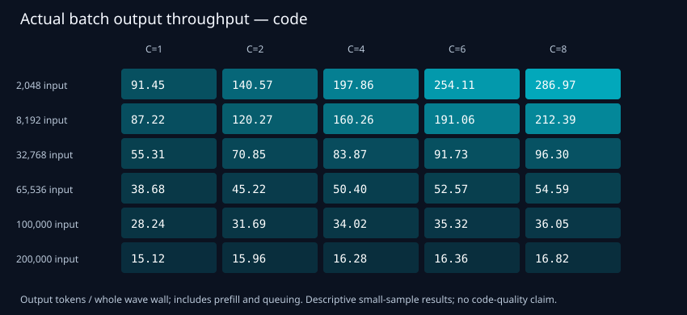
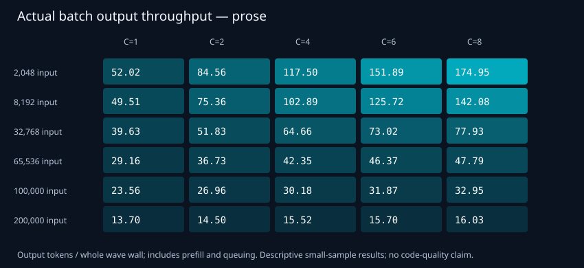
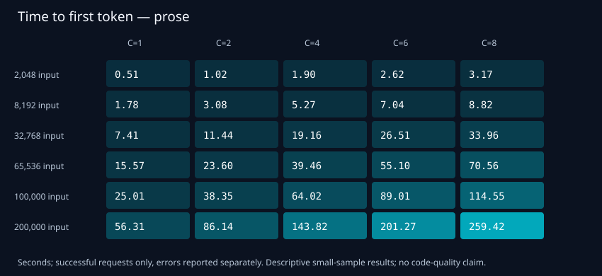

# DeepSeek V4.1 Flash on 8× DGX Spark — TP8 recipe and concurrency results

**Private review repository. Main/foreground results independently reviewed; corrective soak separately validated. Portable source/configuration recipe included; a fresh rebuilt eight-node deployment is NOT yet qualified. No public forum post has been made.**

This is the **eight-node SGLang TP8/EP8 setup**, not the separate two-node EXL3/TensorFold configuration. The presentation follows that project's recipe/results layout, but the engines, checkpoint format, topology and measurements differ.

## Recipe and quick start

- [Operator recipe and prerequisites](docs/RECIPE.md)
- [Exact source pins and qualification boundaries](docs/PROVENANCE.md)
- [Example local configuration](config/tp8.env.example) — no live addresses or credentials
- [Pinned recipe lock](config/recipe.lock.json) and [measured effective-runtime projection](config/measured-runtime.json)
- [Methods](docs/METHODS.md), [disclosed deviations](docs/DEVIATIONS.md), [full matrix CSV](results/matrix.csv), and [forum draft](FORUM_POST.md)

```bash
git clone https://github.com/jlacroix82/DeepSeek-V4.1-Flash-1017-SGLang-TP8-8x-DGX-Spark.git
cd DeepSeek-V4.1-Flash-1017-SGLang-TP8-8x-DGX-Spark
cp config/tp8.env.example .env.tp8
python3 tools/recipe.py plan --env-file .env.tp8
python3 -m unittest discover -s tests -v
python3 tools/check_results.py
```

The plan is local-only. Source preparation is a separate, source-only Git fetch. Edit the example before rendering a runtime profile. Build/share/pack/serve remain behind explicit execution and unqualified-port acknowledgement gates; the saved serving results do not automatically qualify a newly rebuilt image. [Read the recipe before executing any serving action.](docs/RECIPE.md)

## Hardware and serving configuration

One shared model service spans eight DGX Spark/GB10 hosts over 200GbE RoCE. TP=8 and EP=8; official DeepSeek-V4.1-Flash-1017 weights; RoCEnante all-reduce and DSPARK speculation; FP8 E4M3 KV with 256-token pages; Radix prefix cache enabled and hierarchical offload disabled. Configured context is 1,048,576 tokens per request. The shared configured pool is 6,600,000 tokens (6,599,936 allocated); the backend's 32-request admission ceiling is **not a measured useful-agent concurrency recommendation**. DSPARK block size5 corresponds to six native configured speculative tokens.

## Results

A six-hour serving study of the official DeepSeek-V4.1-Flash-1017 checkpoint on one shared **SGLang TP8/EP8** service, with **RoCEnante and DSPARK**, connected over **200GbE RoCE**. The goal is a practical concurrency limit, not the largest configured request count.

**972 protocol-qualified request observations, zero recorded request errors.** The main matrix covers six prompt sizes × five concurrency levels × two output workloads × three repetitions: 180 waves and 756 requests. A further 126 requests measure foreground interference, and the separately qualified corrective soak completed 90 requests. Retained but excluded: 17 pilots/warmups and the original 96-request unqualified soak. All 1,085 retained responses remain auditable; no data were erased.

## Main finding

Eight-way operation is stable in this study, but it is not always a sensible interactive operating point. Short prompts gain real batch throughput as concurrency rises. For long cold prompts, total throughput flattens while first-token delays and delivery stalls grow. An available request slot is not a foreground-latency guarantee.

## Short-context performance — 2,048 input / 1,024 output tokens per request

| Workload | C | Decode tok/s/request | Actual whole-batch output tok/s | Request TTFT p50 s |
|---|---:|---:|---:|---:|
| code | 1 | 99.85 | 91.45 | 0.52 |
| code | 4 | 54.10 | 197.86 | 1.87 |
| code | 6 | 50.38 | 254.11 | 2.50 |
| code | 8 | 41.34 | 286.97 | 3.13 |
| prose | 1 | 53.84 | 52.02 | 0.51 |
| prose | 4 | 31.25 | 117.50 | 1.90 |
| prose | 6 | 27.58 | 151.89 | 2.62 |
| prose | 8 | 23.84 | 174.95 | 3.17 |

Decode is the median across three wave medians over output tokens 129–641. Actual batch throughput is total generated tokens divided by first-send-to-last-finish wall time, including prefill and queuing. These metrics are not interchangeable.

## Long cold prompts: where concurrency stops paying off

| Workload | Input tokens/request | C | Actual batch output tok/s | Request TTFT p50 s | p95 of per-request maximum token gap, s |
|---|---:|---:|---:|---:|---:|
| code | 100,000 | 2 | 31.69 | 38.21 | 23.92 |
| code | 100,000 | 4 | 34.02 | 63.84 | 74.27 |
| code | 100,000 | 8 | 36.05 | 113.65 | 173.73 |
| prose | 100,000 | 2 | 26.96 | 38.35 | 23.80 |
| prose | 100,000 | 4 | 30.18 | 64.02 | 74.10 |
| prose | 100,000 | 8 | 32.95 | 114.55 | 174.76 |
| code | 200,000 | 2 | 15.96 | 85.59 | 56.94 |
| code | 200,000 | 4 | 16.28 | 144.19 | 172.62 |
| code | 200,000 | 8 | 16.82 | 259.52 | 400.86 |
| prose | 200,000 | 2 | 14.50 | 86.14 | 57.51 |
| prose | 200,000 | 4 | 15.52 | 143.82 | 173.30 |
| prose | 200,000 | 8 | 16.03 | 259.42 | 404.02 |

At 100K coding context, four to eight requests buys only **6.0% more whole-batch output throughput**. Steady decode later in the answer can look healthy while the user has already waited through a long prefill or inter-token stall. The gap statistic is descriptive over the small collected sample, not a population guarantee.

## Foreground responsiveness under background load

A 2,048-token foreground prose request, capped at 128 output tokens, arrives 0.5s after the background send barrier. Three repetitions per condition; all requests remain within total concurrency ≤8. There is no priority scheduler change in this test.

| Background requests | Foreground TTFT p50: 8K input/background | Foreground TTFT p50: 100K input/background |
|---:|---:|---:|
| 0 | 0.53 s | 0.52 s |
| 1 | 1.81 s | 25.30 s |
| 3 | 5.39 s | 76.25 s |
| 5 | 8.92 s | 126.15 s |
| 7 | 12.48 s | 176.54 s |

Even one 100K cold background request delays the short foreground probe by roughly 25s. Reserving an unused admission slot alone does not prevent this interference. These are native request probes, not complete Hermes agent workflows.

## Practical operating interpretation — not automatically applied

- **Offline, short-prompt batches:** six to eight requests can be useful when aggregate throughput matters more than individual response time.
- **Interactive use:** limit background admission, especially long cold prefills. One 8K background request gave roughly1.8s foreground TTFT; three gave roughly5.4s; seven roughly12.5s.
- **Long cold100K–200K inputs:** lower concurrency is a better latency tradeoff. Consider serializing long-prefill admission or scheduling it away from interactive work; more slots alone is not a QoS solution.
- A global agent cap cannot be selected from token rates alone. Prefix-reusing, real tool/coding tasks and any priority/admission policy still need separate evaluation. No caps or runtime settings were changed by this study.

## Soak and validation

**Original soak: unqualified protocol deviation.** Its 96 requests were code-only, not a code/prose mix. The study client peak was eight, but the backend reported nine requests in 182 of 1,863 samples. That attempt is retained and excluded from the primary qualified-request count; root cause is not established. The corrective attempt is a separate campaign, not an overwritten or silently pooled retry.

**Corrective soak: qualified under a changed admission policy.** A separate 900s admission window completed 90 requests (46 code / 44 prose), with both workloads at all four input lengths, no request errors, cache reuse or retractions. Client peak was eight and backend peak was eight across 1,818 samples, with no unknown probes or observed envelope excess. The final drain made the span 914.40s. It uses backend-aware paced admission (at least 0.25s between new reservations), so this is a bounded stability observation, not a peak-throughput comparison with the original soak or a guarantee of low interactive latency.

All 1,085 retained payload hashes, exact input lengths/output budgets, native counts and terminal finish reasons were checked. Offline replay of 281,078 native SSE frames matched the saved final output IDs and counters. Every generation was length-capped: this is not code correctness, natural answer completion or useful full-agent throughput. In the original six-hour study all eight serving instances stayed unchanged across 448 periodic observations, with minimum sampled host MemAvailable about 29.1GiB. The corrective return-control checks also passed; sampled observation is not a guarantee against instantaneous pressure.

## Effective serving setup

- Official DeepSeek-V4.1-Flash-1017 checkpoint; one model service, TP8/EP8 across eight DGX Spark / GB10 nodes.
- Configured per-request context: 1,048,576 tokens. Tested input lengths: 2,048; 8,192; 32,768; 65,536; 100,000; 200,000. No full-window retrieval/quality claim.
- Configured KV token pool 6,600,000; native allocated capacity 6,599,936; FP8 E4M3 KV; 256-token pages. KV dtype is not a claim of uniform FP8 model weights. Physical KV allocation in GiB is not established here.
- Maximum running requests 32 is an admission ceiling; only up to eight study-owned requests were exercised.
- DSPARK: six configured draft tokens. Chunked prefill 4,096; max prefill tokens 32,768. Radix prefix cache enabled, hierarchical cache disabled.
- These are the observed deployment settings, not portable safety defaults.

## Files and methods

- [Full 60-cell matrix](results/matrix.csv), including three-wave dispersion, successful-request latencies, gaps and validation flags.
- [Foreground interference](results/foreground.csv).
- [Summary and serving profile](results/summary.json).
- [Separate corrective-soak evidence](results/soak-correction.json) and [retained deviations](docs/DEVIATIONS.md).
- [Sanitized native event-count/timing observations](results/observations.json.gz).
- [Measurement definitions and limitations](docs/METHODS.md).

### Code workload




### Prose workload




## Scope and credit

Synthetic repeated-note prefill, temperature 0, suppressed thinking, separate code/prose instruction suffixes and unique early prefixes. Native cached_tokens was 0 throughout; monitored load did not exceed the wave envelope, with no failed load probes in the main matrix. Scheduled producers were quieted, but this is not a proof that every possible external client was absent.

This repository combines a **validated results report** with a **review-stage pinned-source/configuration recipe**. It is not a freshly qualified one-command deployment kit. No weights, credentials, private operational scripts or complete raw environment/stream dumps are redistributed. The frozen collector/protocol hashes remain in the summary; the observation export omits bodies, nonces, text and full token IDs. `results/summary.json` retains the historical draft-stage publication metadata; the current GitHub repository is private for review. Clean-machine serving/performance reproduction remains explicitly NOT_RUN. See [provenance and gates](docs/PROVENANCE.md).

Credit to DeepSeek, SGLang, RoCEnante, DSPARK and Nous Research / Hermes contributors. The source recipe derives from [MiaAI-Lab's DGX Spark work](https://github.com/MiaAI-Lab/DeepSeek-v4.1-Flash-DGX-Sparks); its AGPL licence, original MIT attribution and component notices are retained. This is a deployment and measurement contribution, not authorship of those engines. The presentation was inspired by [Elevatormusic's two-Spark TensorFold recipe](https://github.com/Elevatormusic/DeepSeek-V4.1-Flash-1017-EXL3-TensorFold-2x-DGX-Spark); different hardware, checkpoint formats, workloads and metrics mean no direct speedup claim against that recipe.
